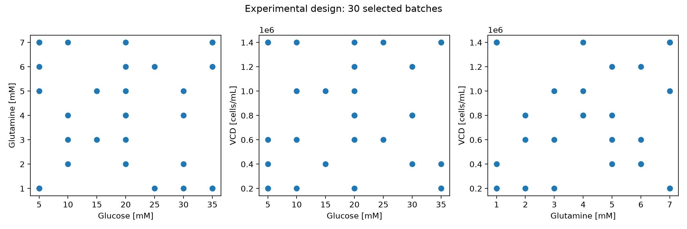
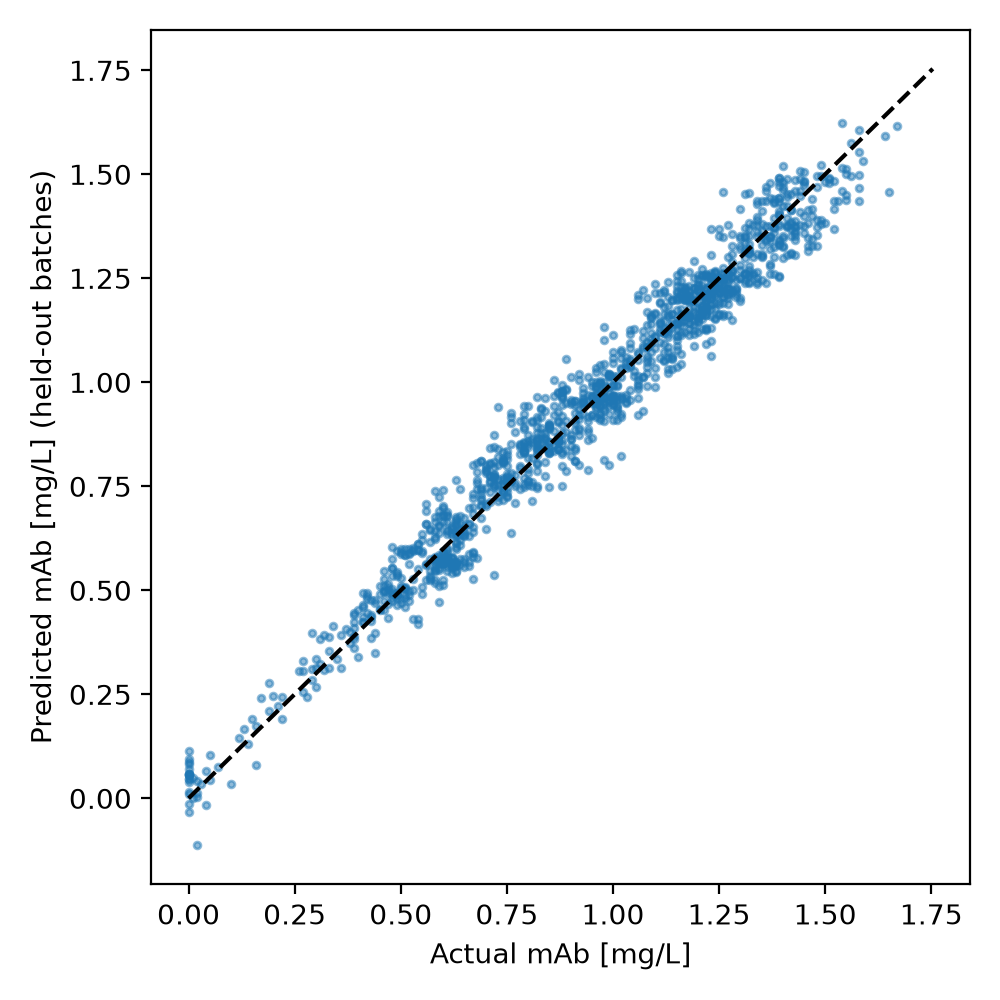
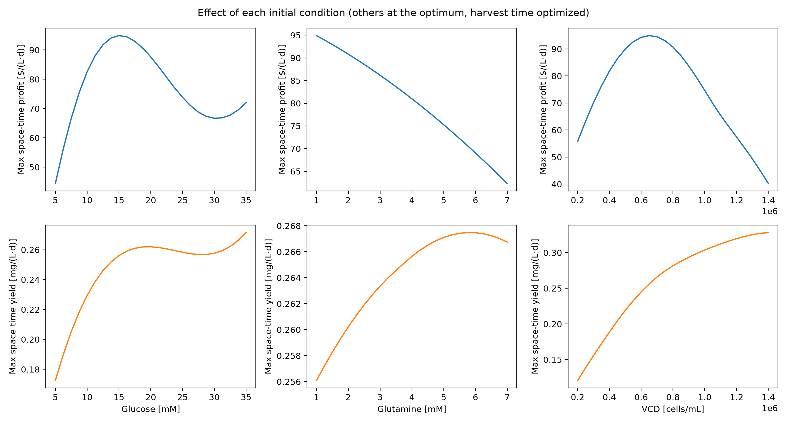
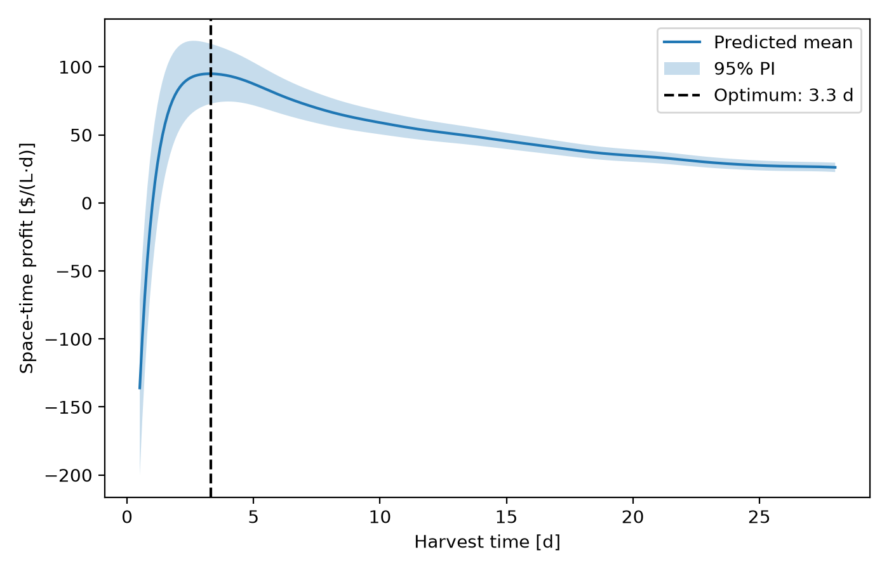

# Monoclonal Antibody Production Optimization

This project uses Gaussian process regression to find the initial glucose concentration, initial glutamine concentration, initial viable cell density, and harvest time that maximize the space-time profit of a monoclonal antibody (mAb) bioprocess. Trained on 30 carefully chosen simulated batch runs, the model predicts antibody titre with calibrated uncertainty, which makes it possible to rank process conditions by profit and report 95% prediction intervals on the recommended operating point.

## Highlights

- Designed a 30-batch space-filling experiment (cube corners, a center point, and scrambled Sobol points) from a 1,029-run grid to cover the full range of three process inputs.
- Built a Gaussian process with an anisotropic Matérn kernel and validated it with batch-grouped cross-validation, reaching R² = 0.969 and 94.3% coverage of its 95% prediction intervals on unseen batches.
- Compared the Gaussian process against gradient boosting and cubic ridge regression, using error and interval calibration to justify the final model.
- Optimized space-time profit over four variables with a two-stage grid search, recommending $94.9/(L·d) at 15 mM glucose, 1 mM glutamine, 650,000 cells/mL, and a 3.3 d harvest.
- Engineered a reproducible pipeline in which a single `main.py` regenerates every table and figure.

## Environment

- Python 3.13.16
- matplotlib 3.11.2
- numpy 2.5.4
- pandas 3.0.6
- scikit-learn 1.9.1
- scipy 1.18.1

## Code Design

Running `python main.py` executes six stages in order. Each stage writes its results to `tables/` or `figures/`, so every number in the Analysis below can be traced to a file.

### Design Selection

The first stage decides which 30 of the 1,029 available batches to use. It reads `initial_conditions.csv`, identifies the seven levels of each variable, and builds a design from the eight corners of the experimental cube, the center point, and further points from a scrambled Sobol sequence that are snapped to the nearest grid level. For every chosen combination, one of the three replicates is picked at random with a fixed seed. This stage exists because the experimental budget is the main constraint: the 30 runs must tell the model about the whole input space before any training happens. It saves `tables/design.csv`, which records exactly which files the rest of the pipeline reads, so every later stage depends on it.

### Data Loading and Preprocessing

The batch files contain only time series, so this stage attaches the three initial conditions from the design table to every row of each selected batch. Time is converted from hours to days to match the units of the economics, and the batch ID is kept so rows can later be grouped. Every second time point (every 16 h) is retained, which reduces each batch from 85 to 43 rows and gives 1,290 rows in total. Subsampling is necessary because Gaussian process training cost grows with the cube of the number of rows, and neighbouring 8 h measurements are nearly redundant. The output is one tidy table in which each row maps glucose, glutamine, viable cell density, and time to an mAb concentration, so every later stage is a regression on four features.

### Model Comparison

Three regressors are evaluated with five-fold cross-validation that groups rows by batch ID, so each batch is held out entirely. Grouping matters because rows from one batch are strongly correlated; a random row split would let the model see close neighbours of every test point and overstate its accuracy. The candidates are a Gaussian process, a cubic polynomial ridge regression, and gradient boosting. Each is scored by R² and RMSE, and the Gaussian process is also scored by the fraction of held-out observations that fall inside its own 95% prediction interval. The results go to `tables/model_comparison.csv`, and the Gaussian process's out-of-fold predictions are kept for a diagnostic plot. This stage provides evidence for choosing the final model rather than relying on preference.

### Final Model Fitting

The selected Gaussian process is refit on all 30 batches. Cross-validation models each saw only about 80% of the batches, so the final model is retrained to use every available observation. This single fitted object supplies the predictive mean and standard deviation behind every recommendation, interval, and optimization figure that follows.

### Optimization

This stage turns predicted mAb concentrations into economics. For each candidate point it computes the cell culture cost, the value (1000 × mAb), the space-time profit, and the space-time yield, using a harvest time plus 1 d of downtime as the denominator. A coarse search first covers the entire sampled range (13 levels per input and 1 d steps in time). A fine search then refines around the winner, with steps of 1 mM glucose, 0.25 mM glutamine, 50,000 cells/mL, and 0.1 d, and with limits that keep it inside the sampled range. Two stages are used because one fine grid over the whole space would be too large to predict, while a coarse grid alone would miss the exact peak. At the best point, the 95% prediction interval is the predictive mean ± 1.96 predictive standard deviations, passed through the profit and yield formulas, since cost and harvest time are chosen exactly and only mAb is uncertain. The result is saved to `tables/recommendation.csv`.

### Figures

The final stage produces four figures from the same fitted model and tables: the experimental design, predicted versus actual mAb for held-out batches, space-time profit against harvest time at the optimum, and the effect of each initial condition on profit and yield. They also export `tables/initial_condition_effects.csv`. Producing them in the same run guarantees that the figures always match the reported numbers, and they serve as the evidence used in the Analysis.

## Analysis

### Choice of Initial Conditions for the 30 Batches

The dataset is a 7 × 7 × 7 grid of initial glucose (5 to 35 mM), glutamine (1 to 7 mM), and viable cell density (200,000 to 1,400,000 cells/mL), with three replicates of each combination. With only 30 runs allowed, each one had to be spent where it teaches the model the most. Three principles shaped the design.

First, I included all eight corners of the cube. The objective penalises cost, so the best operating point could plausibly sit near an edge, and a Gaussian process extrapolates poorly. With the corners sampled, every recommendation can be made inside the tested region. Second, I included the center point to anchor the interior of the response surface. Third, I filled the remaining 21 runs with a scrambled Sobol sequence snapped to the grid. Low-discrepancy sequences spread points evenly, avoiding the clumps and empty regions that a plain random sample would leave. Combinations that duplicated an earlier choice after snapping were skipped, and a fixed seed makes the design reproducible.

I chose one replicate for each combination instead of repeating conditions. Replicates mostly measure noise, and the noise level is already estimated from the scatter within each batch's time series, whereas a new combination adds information about the response surface itself. An important consequence is that, although the 30 batches supply 1,290 rows, they contain only 30 distinct combinations of initial conditions. The model's knowledge of how glucose, glutamine, and cell density matter rests on those 30 points, while the time dimension is far better sampled.

The figure shows coverage of all three pairwise projections, including the extremes, with no large empty regions. Thirty points in three dimensions are still sparse, so some regions have only a few neighbours.

### Model Selection and Hyperparameters

I selected a Gaussian process because the problem has few distinct conditions, a smooth response, and a need for honest uncertainty to produce prediction intervals. The kernel is a constant scale multiplied by a Matérn kernel with ν = 2.5, plus a white-noise term. The Matérn 5/2 form assumes a smooth, twice-differentiable response without the extreme rigidity of a squared-exponential kernel, which suits the rapid rise and plateau seen in the mAb time courses. The kernel uses a separate length scale for each input (automatic relevance determination), because the inputs clearly do not matter equally. The white-noise term absorbs the measurement noise visible in every batch.

Inputs are standardised and the target is normalised. Hyperparameters were learned by maximising the log marginal likelihood, with two extra optimizer restarts to reduce the chance of a poor local optimum, rather than by a separate grid search. Fitted on all data, the length scales (in standardised units) were about 9.7 for glucose, 58 for glutamine, 8.9 for cell density, and 2.4 for time. Time is therefore the most influential input and glutamine the least. The values of ν and the number of restarts were chosen in advance and not tuned, and the random seed is fixed at 42.

### Comparison with Alternatives

All models were scored on batches they had never seen, using five-fold cross-validation grouped by batch.

| Model | R² | RMSE [mg/L] | 95% coverage |
|---|---|---|---|
| Gaussian process | 0.969 | 0.062 | 0.943 |
| Gradient boosting | 0.952 | 0.077 | not available |
| Cubic polynomial ridge | 0.909 | 0.105 | not available |

The Gaussian process has the highest R², and its RMSE is about 19% lower than gradient boosting and about 41% lower than the cubic ridge. Its 95% intervals contained 94.3% of held-out observations, very close to the nominal 95%, so the intervals can be trusted. The cubic polynomial is easy to interpret, but it is too stiff to follow a curve that rises steeply and then flattens. Gradient boosting gives piecewise-constant predictions, cannot extrapolate, and offers no native uncertainty.

One fairness caveat: I used a cubic polynomial with ridge strength 1.0 and default gradient boosting settings without tuning them, so part of the gap may reflect tuning effort. I also did not test whether the differences are statistically significant. Even so, only the Gaussian process delivers calibrated prediction intervals, which the task requires.

Held-out predictions follow the 1:1 line from 0 to about 1.7 mg/L with no visible curvature or fan shape. The remaining scatter is similar in size to the noise in the raw time courses.

### Advantages and Limitations

The model's advantages are smooth interpolation from little data, built-in uncertainty, few hyperparameters, and length scales that can be read as a sensitivity ranking. The interval calibration was verified on unseen batches. Its limitations are as follows.

- **Glutamine sits on the edge of the tested range.** The recommended 1 mM is the lowest value sampled. The data cannot say whether less glutamine would raise profit further, and going lower would be extrapolation.
- **Only 30 distinct conditions inform the response to initial conditions.** Interactions between inputs are learned from sparse data.
- **The optimum is chosen by maximising a predicted mean,** so the reported profit is probably slightly optimistic, and the intervals do not account for that selection.
- **Cost and harvest time are treated as exact,** so only mAb carries uncertainty.
- **Noise is modelled as independent between time points,** although real noise could be correlated within a batch. The 94.3% coverage suggests this is acceptable here.
- **The data are simulated, and the economics assume a fixed 1 d downtime.** Nothing has been validated on a real bioreactor.
- **Cubic scaling limits the Gaussian process to a few thousand rows,** which is why I subsampled the time points.

### Influence of Initial Conditions on Profit and Yield

The figure below varies one initial condition at a time while holding the other two at the recommended values. At each point, the harvest time is re-optimised within 1 to 14 d. It has no uncertainty bands and does not show interactions, so only the large trends should be trusted.

**Glucose.** Space-time profit rises from roughly $44/(L·d) at 5 mM to its peak of about $95 near 15 mM. Below that the cells run short of substrate. Above it, each extra mM costs $10/L without enough extra mAb to repay it, and profit falls to roughly $67 near 30 mM. The small rise toward 35 mM is probably an artefact of sparse data, so I do not interpret it. Yield rises with glucose until about 15 to 20 mM and then flattens near 0.26 mg/(L·d).

**Glutamine.** Profit falls steadily from about $95 at 1 mM to about $62 at 7 mM, while yield barely changes, from about 0.256 to 0.268 mg/(L·d), a gain of under 5%. At roughly $20/L per mM and a harvest near 4 d including downtime, the added cost alone is about $5 per (L·d) for each mM, which is close to the observed decline. Extra glutamine is therefore mostly wasted money in this model, consistent with its very long fitted length scale.

**Viable cell density.** Profit peaks near 650,000 cells/mL at about $95, falls to about $56 at 200,000 cells/mL because too few cells produce too little antibody, and falls to about $40 at 1.4 million cells/mL because the seeding cost ($700/L) outweighs the extra product. Yield, which ignores cost, keeps increasing with cell density, from about 0.12 to 0.33 mg/(L·d), with diminishing returns.

**Profit versus yield.** The two objectives disagree. Yield rewards more cells and more nutrients because it counts none of their cost, so the yield-optimal conditions are much more expensive than the profit-optimal ones. The harvest time that maximises yield is also earlier than the one that maximises profit. This is why the recommendation targets profit.

### Recommended Conditions

| Quantity | Estimate | 95% prediction interval |
|---|---|---|
| Initial glucose [mM] | 15 | not applicable |
| Initial glutamine [mM] | 1 | not applicable |
| Initial VCD [cells/mL] | 650,000 | not applicable |
| Harvest time [d] | 3.3 | not applicable |
| Cell culture cost [$/L] | 495 | not applicable |
| Cell culture value at harvest [$/L] | 903 | 808 to 998 |
| Space-time profit [$/(L·d)] | 94.9 | 72.9 to 117.0 |
| mAb space-time yield [mg/(L·d)] | 0.210 | 0.188 to 0.232 |

The cost follows directly from the formula: 10 × 15 + 20 × 1 + 0.0005 × 650,000 = $495/L. The predicted mAb concentration at harvest is about 0.90 mg/L, which gives a value of $903/L. The space-time profit is ($903 − $495) divided by 4.3 d (3.3 d of culture plus 1 d of downtime).

Profit is strongly negative before about 1.5 d because little antibody has accumulated, climbs steeply, peaks near 3.3 d, and then declines slowly as extra days dilute the profit. Harvesting a little late therefore costs much less than harvesting early. The interval is widest near the peak, about ±$22/(L·d), because mAb is changing fastest there.

The optimum is flat in the cell density and harvest time. The coarse search alone landed on 700,000 cells/mL and 3 d with a profit of $94.4/(L·d), within about 0.5% of the refined result. In practice, seeding between about 600,000 and 700,000 cells/mL and harvesting at 3 to 4 d should perform equivalently within the model's uncertainty. The glutamine recommendation is the one to treat cautiously, because it lies at the boundary of the experimental region and should be tested below 1 mM before it is trusted.

Supporting files are in `tables/` (`design.csv`, `model_comparison.csv`, `recommendation.csv`, `initial_condition_effects.csv`) and `figures/`.